# lab4web
layout sederhana
LAPORAN PRATIKUM 4
1.	Persiapan membuat dokumen HTML dengan nama file lab4_box.html seperti berikut.

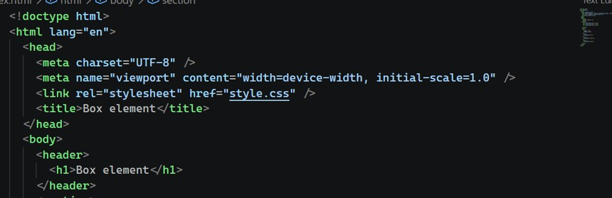

Membuat Box Element
 
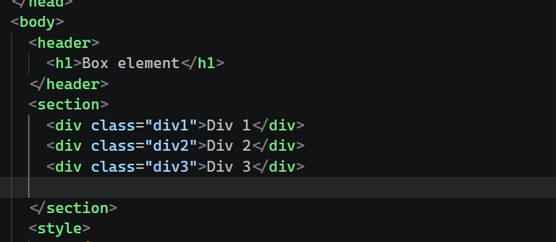
CSS Float Property
 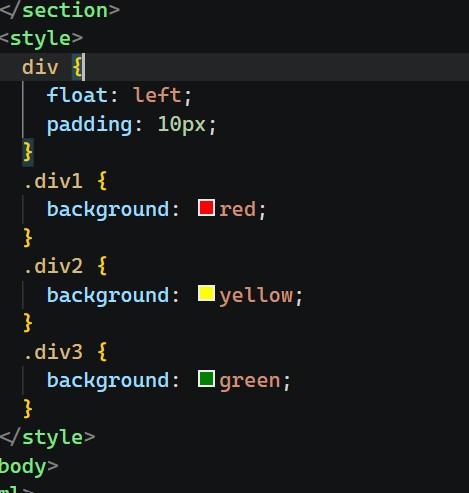

Hasil running

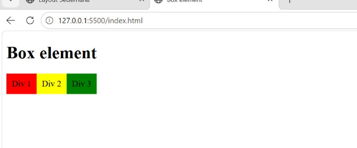

2.	Mengatur Clearfix Element
 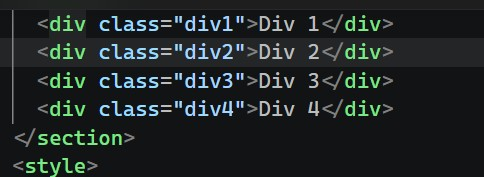
Pengaturan css
 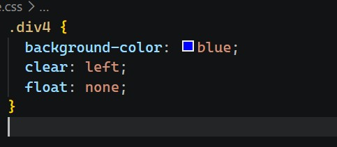

HASILL
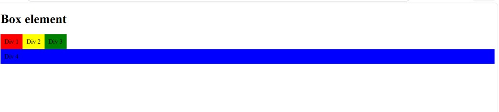
 
             Eksperimen terhadap penggunaan property clear dengan nilai lainnya (left, both,
right), dan amati perubahannya.
•	Pada saat di properti clear di ganti valaue both maka tidak ada perubahan sama seperti left
 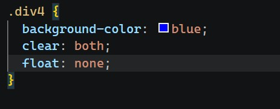
 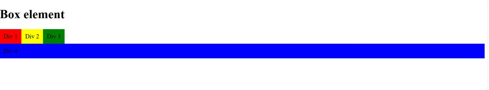

•	Pada saat di properti clear di ganti valaue raight makan posisi div 4 pindah ke samping div3
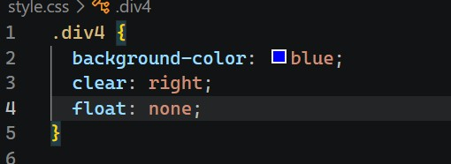
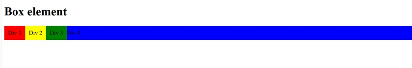

Membuat layout sederhana
 
 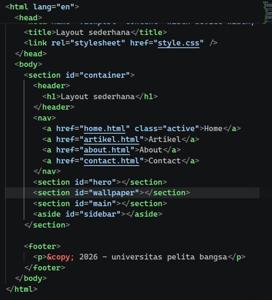
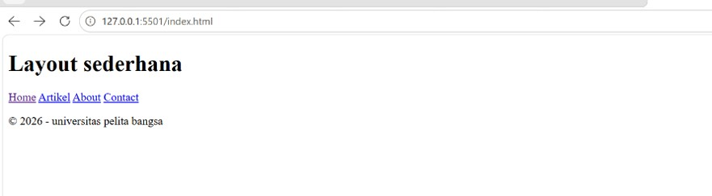
Penambahan css
 

  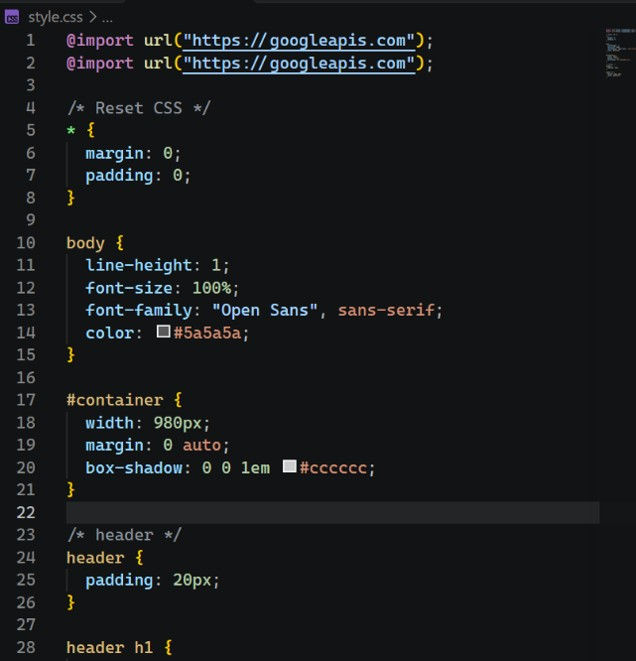
  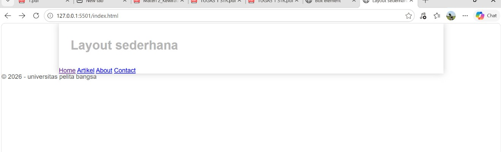

Membuat Navigasi

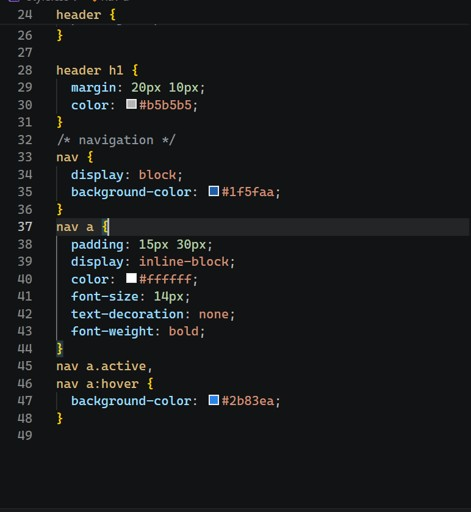
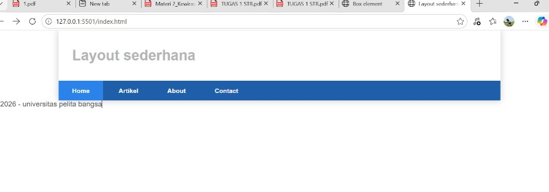
Membuat Hero Panel.
 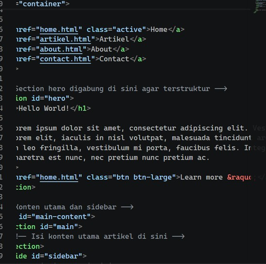
 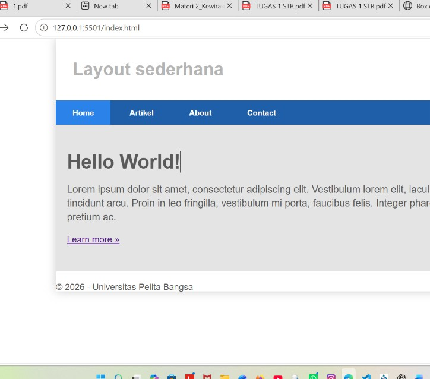

Mengatur Layout Main dan Sidebar
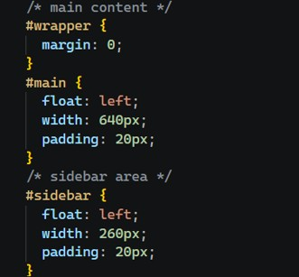

Membuat Sidebar Widget
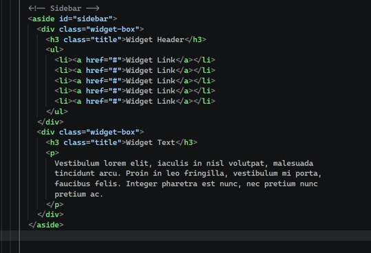
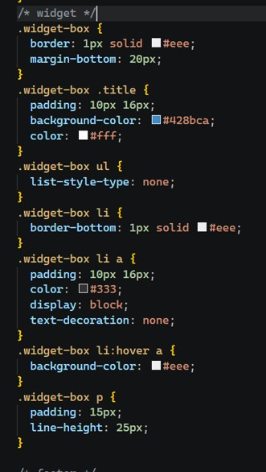
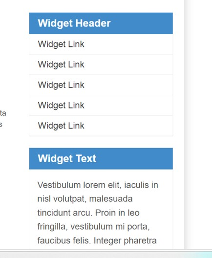
  

Mengatur Footer
 

Menambahkan Elemen lainnya pada Main Content
 

Menambahkan Content Artikel

 

 

Pertanyaan dan Tugas
1. Tambahkan Layout untuk menu About
      

 

2. Tambahkan layout untuk menu Contact

   

